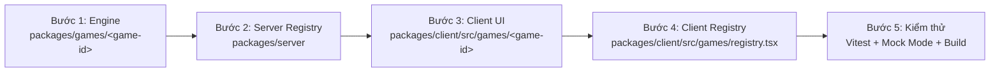

# Hướng dẫn Kỹ thuật: Thêm Board Game Mới vào Nền tảng

Tài liệu này cung cấp hướng dẫn toàn diện từ kiến trúc, quy chuẩn mã nguồn cho đến từng bước thực hành để tích hợp một board game mới vào hệ thống Web Board Game Monorepo.

---

## 1. Kiến trúc Tổng quan

Hệ thống được thiết kế theo mô hình **Monorepo (pnpm workspaces)**, tách biệt nghiêm ngặt giữa logic trò chơi (pure engine), máy chủ điều phối thời gian thực (authoritative server) và giao diện di động (mobile-first client).

```
boardgame-monorepo/
├── packages/
│   ├── core/                      # Giao thức mạng, interface GameDefinition, Rng, helpers chung
│   ├── games/
│   │   ├── side-effects/          # Game 1: Side Effects (engine thuần)
│   │   └── <game-id>/             # Game mới của bạn (ví dụ: tic-tac-toe, uno, coup, ...)
│   ├── server/                    # Socket.IO Server, quản lý phòng, bot runner, timer
│   └── client/                    # React + Vite + PWA, UI mobile-first, bàn chơi
```

### Các nguyên tắc thiết kế cốt lõi

1. **Server là trọng tài tối cao (Authoritative Server)**:
   - Client **không bao giờ** tự tính toán hay thay đổi trạng thái ván chơi.
   - Client chỉ gửi `Action` (ý định người chơi) lên máy chủ qua WebSocket.
   - Mọi kiểm tra hợp lệ (`validate`) và cập nhật trạng thái (`apply`) đều được thực thi ở máy chủ thông qua Game Engine.

2. **Game Engine thuần túy (Pure Functional Engine)**:
   - Các hàm `setup`, `validate`, `apply`, `playerView`, `winner` là **pure functions**, hoàn toàn không chứa side-effects (không gọi I/O, không truy cập Date.now, không gọi mạng).
   - **Tuyệt đối không dùng `Math.random()`**: Mọi yếu tố ngẫu nhiên (chia bài, xáo bài, gieo xúc xắc) phải thông qua đối tượng `Rng` được truyền vào từ `packages/core`. Nhờ vậy, ván đấu có thể tái hiện chính xác (replay) bằng `seed`.

3. **Bảo mật & Che giấu thông tin ẩn (Information Hiding)**:
   - Hàm `playerView(state, playerId): PlayerView` có nhiệm vụ biến đổi toàn bộ `State` thành góc nhìn riêng biệt của người chơi `playerId`.
   - **Không bao giờ gửi full state về client**. Server chỉ gửi `playerView` tương ứng tới socket của từng người chơi.
   - Dữ liệu ẩn (bài trên tay đối thủ, thứ tự các lá bài trong chồng rút, danh tính bí mật...) phải được loại bỏ hoặc thay thế bằng số lượng (`handCount`, `deckRemaining`).

4. **Tách biệt ranh giới (Separation of Concerns)**:
   - Logic chung của platform (tạo phòng, mã phòng, chat, danh sách người chơi trong phòng, kết nối lại) thuộc về `packages/core`, `packages/server`, `packages/client/src/lobby`.
   - Logic riêng của từng game nằm trọn vẹn trong `packages/games/<game-id>` (engine) và `packages/client/src/games/<game-id>` (giao diện).

---

## 2. Quy trình 5 Bước Thêm Một Game Mới

Quy trình chuẩn gồm 5 bước tuần tự:



---

### Bước 1: Tạo Package Logic Game (`packages/games/<game-id>`)

Tạo thư mục mới: `packages/games/<game-id>`.

#### 1.1. Cấu hình `package.json`
Tạo file `packages/games/<game-id>/package.json`:

```json
{
  "name": "@boardgame/game-<game-id>",
  "version": "0.1.0",
  "private": true,
  "type": "module",
  "main": "./dist/index.js",
  "types": "./dist/index.d.ts",
  "exports": {
    ".": {
      "types": "./dist/index.d.ts",
      "import": "./dist/index.js"
    }
  },
  "scripts": {
    "build": "tsc",
    "typecheck": "tsc --project tsconfig.test.json --noEmit",
    "test": "vitest run"
  },
  "dependencies": {
    "@boardgame/core": "workspace:*"
  }
}
```

#### 1.2. Cấu hình TypeScript
Tạo file `packages/games/<game-id>/tsconfig.json`:

```json
{
  "extends": "../../tsconfig.base.json",
  "compilerOptions": {
    "rootDir": "src",
    "outDir": "dist"
  },
  "include": ["src/**/*"]
}
```

Tạo file `packages/games/<game-id>/tsconfig.test.json`:

```json
{
  "extends": "./tsconfig.json",
  "compilerOptions": {
    "types": ["vitest/globals", "node"]
  },
  "include": ["src/**/*", "test/**/*"]
}
```

#### 1.3. Định nghĩa kiểu dữ liệu (`src/types.ts`)
Xác định 3 kiểu cốt lõi:
- `State`: Toàn bộ dữ liệu của bàn cờ / ván đấu (lưu trên server).
- `Action`: Các hành động người chơi có thể gửi lên.
- `PlayerView`: Dữ liệu đã che thông tin ẩn gửi về máy khách của từng người chơi.

*Ví dụ minh họa:*
```typescript
export interface PlayerState {
  id: string;
  hand: string[];       // Danh sách lá bài bí mật
  score: number;
}

export interface MyGameState {
  players: Record<string, PlayerState>;
  playerOrder: string[];
  activePlayerId: string;
  drawDeck: string[];   // Chồng bài bí mật
  discardPile: string[];
  winner: string | null;
  turn: number;
}

export type MyGameAction =
  | { type: 'DRAW_CARD' }
  | { type: 'PLAY_CARD'; cardId: string }
  | { type: 'END_TURN' };

export interface MyGamePlayerView {
  myId: string;
  activePlayerId: string;
  myHand: string[];     // Bài của chính mình
  opponents: {
    id: string;
    handCount: number;  // Đối thủ chỉ thấy số lượng bài
    score: number;
  }[];
  drawDeckRemaining: number;
  topDiscard: string | null;
  winner: string | null;
}
```

#### 1.4. Xây dựng Pure Engine

##### `src/setup.ts`: Khởi tạo ván chơi
```typescript
import type { Rng } from '@boardgame/core';
import type { MyGameState } from './types.js';

export function setupGame(playerIds: string[], _options: unknown, rng: Rng): MyGameState {
  // 1. Tạo và xáo bộ bài bằng rng
  const deck = ['CARD_A', 'CARD_B', 'CARD_C', 'CARD_D', 'CARD_E', 'CARD_F'];
  const shuffledDeck = rng.shuffle(deck);

  // 2. Chia bài cho người chơi
  const players: MyGameState['players'] = {};
  for (const pid of playerIds) {
    players[pid] = {
      id: pid,
      hand: shuffledDeck.splice(0, 2),
      score: 0,
    };
  }

  return {
    players,
    playerOrder: [...playerIds],
    activePlayerId: playerIds[0] ?? '',
    drawDeck: shuffledDeck,
    discardPile: [],
    winner: null,
    turn: 1,
  };
}
```

##### `src/validate.ts`: Kiểm tra hợp lệ (Rule Validator)
Trả về `null` nếu hành động hợp lệ, hoặc chuỗi tiếng Việt mô tả lỗi để hiển thị Toast trên Client nếu vi phạm.

```typescript
import type { MyGameState, MyGameAction } from './types.js';

export function validateGame(state: MyGameState, playerId: string, action: MyGameAction): string | null {
  if (state.winner !== null) {
    return 'Trò chơi đã kết thúc';
  }

  if (playerId !== state.activePlayerId) {
    return 'Chưa đến lượt của bạn';
  }

  switch (action.type) {
    case 'DRAW_CARD':
      if (state.drawDeck.length === 0) {
        return 'Chồng bài rút đã hết';
      }
      return null;

    case 'PLAY_CARD': {
      const player = state.players[playerId];
      if (!player || !player.hand.includes(action.cardId)) {
        return 'Bạn không sở hữu lá bài này';
      }
      return null;
    }

    case 'END_TURN':
      return null;

    default:
      return 'Hành động không xác định';
  }
}
```

##### `src/apply.ts`: Áp dụng hành động (State Transition)
Cập nhật trạng thái theo nguyên tắc bất biến (immutable) và trả về `State` mới.

```typescript
import type { Rng } from '@boardgame/core';
import type { MyGameState, MyGameAction } from './types.js';

export function applyGame(
  state: MyGameState,
  playerId: string,
  action: MyGameAction,
  _rng: Rng
): MyGameState {
  const next = structuredClone(state);
  const player = next.players[playerId];

  switch (action.type) {
    case 'DRAW_CARD': {
      const drawn = next.drawDeck.pop();
      if (drawn) {
        player.hand.push(drawn);
      }
      break;
    }

    case 'PLAY_CARD': {
      const index = player.hand.indexOf(action.cardId);
      if (index !== -1) {
        player.hand.splice(index, 1);
        next.discardPile.push(action.cardId);
        player.score += 10;
        if (player.score >= 50) {
          next.winner = playerId;
        }
      }
      break;
    }

    case 'END_TURN': {
      const currentIndex = next.playerOrder.indexOf(next.activePlayerId);
      const nextIndex = (currentIndex + 1) % next.playerOrder.length;
      next.activePlayerId = next.playerOrder[nextIndex]!;
      next.turn += 1;
      break;
    }
  }

  return next;
}
```

##### `src/player-view.ts`: Lọc góc nhìn người chơi
```typescript
import type { MyGameState, MyGamePlayerView } from './types.js';

export function createPlayerView(state: MyGameState, playerId: string): MyGamePlayerView {
  const myState = state.players[playerId];
  
  const opponents = state.playerOrder
    .filter((id) => id !== playerId)
    .map((id) => {
      const p = state.players[id];
      return {
        id,
        handCount: p ? p.hand.length : 0, // Che giấu danh sách lá bài của đối thủ
        score: p ? p.score : 0,
      };
    });

  return {
    myId: playerId,
    activePlayerId: state.activePlayerId,
    myHand: myState ? [...myState.hand] : [],
    opponents,
    drawDeckRemaining: state.drawDeck.length,
    topDiscard: state.discardPile[state.discardPile.length - 1] ?? null,
    winner: state.winner,
  };
}
```

#### 1.5. Khai báo `GameDefinition` (`src/game.ts`)

Định nghĩa game hoàn chỉnh tuân thủ `GameDefinition<S, A, V>` từ `@boardgame/core`:

```typescript
import type { GameDefinition, Rng } from '@boardgame/core';
import { setupGame } from './setup.js';
import { validateGame } from './validate.js';
import { applyGame } from './apply.js';
import { createPlayerView } from './player-view.js';
import type { MyGameState, MyGameAction, MyGamePlayerView } from './types.js';

export const myNewGame: GameDefinition<MyGameState, MyGameAction, MyGamePlayerView> = {
  id: 'my-new-game',
  minPlayers: 2,
  maxPlayers: 4,
  meta: {
    nameVi: 'Game Mới Tuyệt Vời',
    subtitleVi: 'Game đấu trí thẻ bài tốc độ cao',
    icon: '🎲',
  },
  setup(playerIds: string[], options: unknown, rng: Rng) {
    return setupGame(playerIds, options, rng);
  },
  validate(state: MyGameState, playerId: string, action: MyGameAction) {
    return validateGame(state, playerId, action);
  },
  apply(state: MyGameState, playerId: string, action: MyGameAction, rng: Rng) {
    return applyGame(state, playerId, action, rng);
  },
  playerView(state: MyGameState, playerId: string) {
    return createPlayerView(state, playerId);
  },
  winner(state: MyGameState) {
    return state.winner;
  },
  // Tuỳ chọn: Tự động chạy hành động sau n giây (ví dụ: đếm ngược bỏ lượt)
  scheduledAction(_state: MyGameState) {
    return null;
  },
  // Tuỳ chọn: Tích hợp Bot AI
  bots: [
    {
      level: 'normal',
      labelVi: 'Tập sự',
      chooseAction(view, playerId, _rng) {
        if (view.activePlayerId !== playerId) return null;
        if (view.myHand.length > 0) {
          return { type: 'PLAY_CARD', cardId: view.myHand[0]! };
        }
        return { type: 'DRAW_CARD' };
      },
    },
  ],
  getActionablePlayerId(state: MyGameState, botPlayerIds: ReadonlySet<string>) {
    return botPlayerIds.has(state.activePlayerId) ? state.activePlayerId : null;
  },
  getBotFallbackAction(_state: MyGameState, _playerId: string): MyGameAction {
    return { type: 'END_TURN' };
  },
};
```

Export toàn bộ qua `packages/games/<game-id>/src/index.ts`:
```typescript
export * from './types.js';
export * from './game.js';
```

#### 1.6. Viết Unit Tests (`test/game.test.ts`)
Tạo thư mục `test/` và viết unit test kiểm tra toàn bộ luật:
```typescript
import { describe, it, expect } from 'vitest';
import { createRng } from '@boardgame/core';
import { myNewGame } from '../src/index.js';

describe('MyNewGame Engine', () => {
  const rng = createRng('test-seed-123');
  const players = ['p1', 'p2'];

  it('khởi tạo ván chơi đúng số lượng bài', () => {
    const state = myNewGame.setup(players, {}, rng);
    expect(state.playerOrder).toEqual(['p1', 'p2']);
    expect(state.players['p1']?.hand.length).toBe(2);
    expect(state.winner).toBeNull();
  });

  it('ngăn chặn người chơi hành động khi chưa tới lượt', () => {
    const state = myNewGame.setup(players, {}, rng);
    const err = myNewGame.validate(state, 'p2', { type: 'DRAW_CARD' });
    expect(err).toBe('Chưa đến lượt của bạn');
  });

  it('che giấu bài trên tay đối thủ trong playerView', () => {
    const state = myNewGame.setup(players, {}, rng);
    const viewP1 = myNewGame.playerView(state, 'p1');
    expect(viewP1.myHand.length).toBe(2);
    expect(viewP1.opponents[0]?.handCount).toBe(2);
    // Đảm bảo không có trường nào để lộ mảng bài của đối thủ
    expect((viewP1.opponents[0] as unknown as { hand?: string[] }).hand).toBeUndefined();
  });
});
```

---

### Bước 2: Đăng Ký Game Trên Server (`packages/server`)

#### 2.1. Thêm Dependency vào `packages/server/package.json`
Mở `packages/server/package.json` và bổ sung package game mới:
```json
"dependencies": {
  "@boardgame/core": "workspace:*",
  "@boardgame/game-side-effects": "workspace:*",
  "@boardgame/game-<game-id>": "workspace:*",
  "socket.io": "^4.8.4"
}
```
*Chạy `pnpm install` từ thư mục gốc.*

#### 2.2. Đăng ký vào `GameRegistry` trên Server
Mở file `packages/server/src/registry.ts`:

```typescript
import type { GameDefinition } from '@boardgame/core';
import { sideEffectsGame } from '@boardgame/game-side-effects';
import { myNewGame } from '@boardgame/game-<game-id>'; // 1. Import game mới

export class GameRegistry {
  // eslint-disable-next-line @typescript-eslint/no-explicit-any
  private games = new Map<string, GameDefinition<any, any, any>>();

  // eslint-disable-next-line @typescript-eslint/no-explicit-any
  register(game: GameDefinition<any, any, any>): void {
    this.games.set(game.id, game);
  }

  // eslint-disable-next-line @typescript-eslint/no-explicit-any
  get(gameId: string): GameDefinition<any, any, any> | undefined {
    return this.games.get(gameId);
  }

  has(gameId: string): boolean {
    return this.games.has(gameId);
  }
}

export const defaultRegistry = new GameRegistry();
defaultRegistry.register(sideEffectsGame);
defaultRegistry.register(myNewGame); // 2. Đăng ký game vào registry
```

> **Cơ chế hoạt động**: Khi host tạo phòng với `gameId = 'my-new-game'`, Server sẽ tự động lấy `GameDefinition` tương ứng từ `defaultRegistry`, gọi `setup()` khi bắt đầu, điều phối `validate()` / `apply()`, kích hoạt Bot AI và tự động stream `playerView` về cho các socket đã kết nối.

---

### Bước 3: Tạo Giao Diện Bàn Chơi Phía Client (`packages/client`)

Tạo thư mục: `packages/client/src/games/<game-id>/`.

#### 3.1. Tạo Component Bàn Chơi (`GameBoard.tsx`)
Nhận các props chuẩn từ `ClientGameBoardProps<V, A>`:

```tsx
import React, { useState } from 'react';
import type { ClientGameBoardProps } from '../registry.js';
import type { MyGamePlayerView, MyGameAction } from '@boardgame/game-<game-id>';

export const GameBoard: React.FC<ClientGameBoardProps<MyGamePlayerView, MyGameAction>> = ({
  session,
  roomState,
  gameView,
  onSendAction,
  onLeaveRoom,
}) => {
  const [submitting, setSubmitting] = useState(false);
  const isMyTurn = gameView.activePlayerId === session.playerId;

  const handleAction = async (action: MyGameAction) => {
    if (submitting) return;
    setSubmitting(true);
    try {
      await onSendAction(action);
    } finally {
      setSubmitting(false);
    }
  };

  return (
    <div style={{ maxWidth: '480px', margin: '0 auto', padding: '16px', color: '#fff' }}>
      {/* Thanh thông tin đầu ván đấu */}
      <header style={{ display: 'flex', justifyContent: 'space-between', alignItems: 'center' }}>
        <div>
          <h2 style={{ margin: 0, fontSize: '18px' }}>Phòng: {roomState.roomCode}</h2>
          <span style={{ fontSize: '12px', color: isMyTurn ? '#4ade80' : '#94a3b8' }}>
            {isMyTurn ? '🔥 Đang tới lượt bạn!' : '⏳ Chờ đối thủ đi nước...'}
          </span>
        </div>
        <button
          type="button"
          onClick={onLeaveRoom}
          style={{ background: 'transparent', border: '1px solid #ef4444', color: '#ef4444', borderRadius: '8px', padding: '4px 8px' }}
        >
          Rời phòng
        </button>
      </header>

      {/* Khu vực đối thủ */}
      <section style={{ margin: '20px 0', display: 'flex', gap: '8px' }}>
        {gameView.opponents.map((opp) => (
          <div key={opp.id} style={{ background: '#1e293b', padding: '8px', borderRadius: '8px', flex: 1 }}>
            <div style={{ fontSize: '12px', color: '#cbd5e1' }}>Người chơi: {opp.id.slice(0, 4)}</div>
            <div style={{ fontSize: '14px', fontWeight: 'bold' }}>🃏 {opp.handCount} lá</div>
            <div style={{ fontSize: '12px', color: '#eab308' }}>⭐ {opp.score}đ</div>
          </div>
        ))}
      </section>

      {/* Khu vực bàn chơi / chồng bài */}
      <div style={{ background: '#0f172a', padding: '16px', borderRadius: '12px', textAlign: 'center', marginBottom: '20px' }}>
        <div>Chồng rút còn: <strong>{gameView.drawDeckRemaining}</strong> lá</div>
        <div>Bài vừa đánh: <strong>{gameView.topDiscard ?? '(Trống)'}</strong></div>
      </div>

      {/* Bài trên tay của chính mình */}
      <section>
        <h3>Bài trên tay ({gameView.myHand.length})</h3>
        <div style={{ display: 'flex', gap: '8px', overflowX: 'auto', paddingBottom: '8px' }}>
          {gameView.myHand.map((cardId) => (
            <button
              key={cardId}
              type="button"
              disabled={!isMyTurn || submitting}
              onClick={() => handleAction({ type: 'PLAY_CARD', cardId })}
              style={{
                minWidth: '70px',
                height: '100px',
                background: '#334155',
                border: '1px solid #64748b',
                borderRadius: '8px',
                color: '#fff',
                cursor: isMyTurn ? 'pointer' : 'not-allowed',
              }}
            >
              {cardId}
            </button>
          ))}
        </div>
      </section>

      {/* Nút hành động */}
      <footer style={{ marginTop: '20px', display: 'flex', gap: '8px' }}>
        <button
          type="button"
          disabled={!isMyTurn || submitting}
          onClick={() => handleAction({ type: 'DRAW_CARD' })}
          style={{ flex: 1, padding: '12px', borderRadius: '8px', background: '#3b82f6', color: '#fff', border: 'none' }}
        >
          Rút bài
        </button>
        <button
          type="button"
          disabled={!isMyTurn || submitting}
          onClick={() => handleAction({ type: 'END_TURN' })}
          style={{ flex: 1, padding: '12px', borderRadius: '8px', background: '#eab308', color: '#000', border: 'none', fontWeight: 'bold' }}
        >
          Hết lượt
        </button>
      </footer>
    </div>
  );
};
```

#### 3.2. Tạo Modal Hướng Dẫn Luật Chơi (`RulesModal.tsx`)
Modal hiển thị bằng **tiếng Việt có dấu**, giải thích mục tiêu và các bước chơi:

```tsx
import React from 'react';

export interface RulesModalProps {
  isOpen: boolean;
  onClose: () => void;
}

export const RulesModal: React.FC<RulesModalProps> = ({ isOpen, onClose }) => {
  if (!isOpen) return null;

  return (
    <div
      role="dialog"
      aria-modal="true"
      style={{
        position: 'fixed',
        inset: 0,
        backgroundColor: 'rgba(0,0,0,0.8)',
        display: 'flex',
        alignItems: 'center',
        justifyContent: 'center',
        zIndex: 9999,
        padding: '16px',
      }}
    >
      <div
        style={{
          background: '#1e293b',
          borderRadius: '16px',
          padding: '24px',
          maxWidth: '500px',
          width: '100%',
          maxHeight: '85vh',
          overflowY: 'auto',
          color: '#f8fafc',
        }}
      >
        <h2 style={{ marginTop: 0, color: '#fde047' }}>📖 Luật Chơi: Game Mới Tuyệt Vời</h2>
        
        <h3>1. Mục tiêu ván đấu</h3>
        <p>Người chơi đầu tiên đạt 50 điểm sẽ giành chiến thắng chung cuộc.</p>

        <h3>2. Lượt chơi của bạn</h3>
        <ul>
          <li><strong>Rút bài:</strong> Rút 1 lá từ chồng bài chung.</li>
          <li><strong>Đánh bài:</strong> Đánh 1 lá trên tay xuống để ghi 10 điểm.</li>
          <li><strong>Kết thúc lượt:</strong> Chuyển quyền đi tiếp cho đối thủ kế tiếp.</li>
        </ul>

        <button
          type="button"
          onClick={onClose}
          style={{
            width: '100%',
            padding: '12px',
            borderRadius: '8px',
            background: '#10b981',
            color: '#fff',
            border: 'none',
            fontWeight: 'bold',
            marginTop: '16px',
          }}
        >
          Đã hiểu, sẵn sàng chơi!
        </button>
      </div>
    </div>
  );
};
```

#### 3.3. Dữ liệu Mẫu Phục vụ Mock Dev (`mockGameView.ts`)
Hỗ trợ phát triển giao diện nhanh qua URL query `?mock=1&game=<game-id>` mà không cần bật server:

```typescript
import type { RoomState } from '@boardgame/core';
import type { MyGamePlayerView } from '@boardgame/game-<game-id>';
import type { UserSession } from '../../net/session.js';

export function createMockGameData(searchParams: URLSearchParams): {
  session: UserSession;
  roomState: RoomState;
  gameView: MyGamePlayerView;
  deadline?: number;
} {
  const myId = 'user-me';

  const session: UserSession = {
    playerId: myId,
    name: 'Người chơi Test',
    roomCode: 'TEST9',
    token: 'mock-token',
  };

  const roomState: RoomState = {
    roomCode: 'TEST9',
    gameId: 'my-new-game',
    status: 'in_game',
    hostId: myId,
    players: [
      { id: myId, name: 'Người chơi Test', connected: true },
      { id: 'user-opp1', name: 'Đối thủ Alpha (Bot)', connected: true, isBot: true },
      { id: 'user-opp2', name: 'Đối thủ Beta', connected: true },
    ],
  };

  const gameView: MyGamePlayerView = {
    myId,
    activePlayerId: myId, // Mặc định là lượt của mình để dễ test click
    myHand: ['CARD_A', 'CARD_C', 'CARD_E'],
    opponents: [
      { id: 'user-opp1', handCount: 3, score: 20 },
      { id: 'user-opp2', handCount: 2, score: 10 },
    ],
    drawDeckRemaining: 14,
    topDiscard: 'CARD_B',
    winner: null,
  };

  return { session, roomState, gameView };
}
```

#### 3.4. Tài nguyên tĩnh (Ảnh/Âm thanh nếu có)
Đặt tài nguyên tĩnh tại:
`packages/client/public/games/<game-id>/` (ví dụ: `card-back.png`, `sounds/click.mp3`).
Trong code client, truy cập đường dẫn tuyệt đối: `/games/<game-id>/card-back.png`.

---

### Bước 4: Đăng Ký Game Trên Client Game Registry

#### 4.1. Thêm Dependency vào `packages/client/package.json`
```json
"dependencies": {
  "@boardgame/core": "workspace:*",
  "@boardgame/game-side-effects": "workspace:*",
  "@boardgame/game-<game-id>": "workspace:*",
  ...
}
```

#### 4.2. Khai báo Plugin trong `packages/client/src/games/registry.tsx`
Mở `packages/client/src/games/registry.tsx`:

```tsx
// 1. Import game definition, types và UI components
import { myNewGame, type MyGameAction, type MyGamePlayerView } from '@boardgame/game-<game-id>';
import { GameBoard as MyNewGameBoard } from './<game-id>/GameBoard.js';
import { RulesModal as MyNewGameRulesModal } from './<game-id>/RulesModal.js';
import { createMockGameData as createMyNewGameMockData } from './<game-id>/mockGameView.js';

// ... các plugin khác ...

// 2. Định nghĩa Plugin
export const myNewGameClientPlugin: ClientGamePlugin<MyGamePlayerView, MyGameAction> = {
  id: 'my-new-game',
  game: myNewGame,
  title: myNewGame.meta?.nameVi ?? 'Game Mới Tuyệt Vời',
  subtitle: myNewGame.meta?.subtitleVi ?? 'Game đấu trí thẻ bài tốc độ cao',
  icon: myNewGame.meta?.icon ?? '🎲',
  accentColor: '#3b82f6',
  durationTextVi: '10-20 phút',
  categoryVi: 'Thẻ bài đối kháng',
  rulesStorageKey: 'my_new_game_rules_read',
  BoardComponent: MyNewGameBoard,
  RulesModalComponent: MyNewGameRulesModal,
  createMockData: createMyNewGameMockData,
};

// 3. Đăng ký vào Registry
clientGameRegistry.register(myNewGameClientPlugin);
```

#### 4.3. Tự động hiển thị trên Giao diện
Ngay khi bạn gọi `clientGameRegistry.register(myNewGameClientPlugin)`:
1. `HomePage.tsx` tự động phát hiện số lượng game > 1 và hiển thị **Bộ chọn Game (Game Selector)**.
2. Người dùng có thể bấm chuyển đổi giữa các game, xem biểu tượng, tên game, mở modal luật chơi riêng biệt của từng game.
3. Khi bấm **Tạo phòng**, phòng mới sẽ được tạo với `gameId` đã chọn.
4. Trong sảnh chờ (`LobbyRoomPage.tsx`), số lượng người chơi tối thiểu/tối đa (`minPlayers`/`maxPlayers`) được đồng bộ trực tiếp từ `GameDefinition`.

---

### Bước 5: Kiểm Thử và Xác Thực (Verification)

#### 5.1. Chạy Unit Test Engine
```bash
# Kiểm tra riêng package game mới
pnpm --filter @boardgame/game-<game-id> test

# Chạy toàn bộ test của dự án
pnpm test
```

#### 5.2. Kiểm tra Mock UI trên Trình duyệt
Mở client dev server (`pnpm --filter @boardgame/client dev`) và truy cập URL:
```
http://localhost:5173/?mock=1&game=<game-id>
```
- Mở DevTools ở chế độ **Device Emulation (375px - iPhone SE/XR)**.
- Kiểm tra các tương tác: click nút, đánh bài, đổi kích thước màn hình, kiểm tra tràn viền (overflow).
- Mở modal luật chơi để kiểm tra giao diện tiếng Việt.

#### 5.3. Build toàn bộ Monorepo
Đảm bảo TypeScript không có lỗi kiểu và Vite bundle hoàn tất:
```bash
pnpm build
```

#### 5.4. Kiểm thử kết nối phòng thực tế (End-to-End)
1. Khởi động server: `pnpm --filter @boardgame/server start`.
2. Khởi động client: `pnpm --filter @boardgame/client dev`.
3. Mở 2 tab trình duyệt ẩn danh:
   - Tab 1: Tạo phòng với game mới, kiểm tra mã phòng (ví dụ `ABC23`).
   - Tab 2: Nhập mã phòng và tham gia.
   - Thêm Bot (nếu có cấu hình Bot) hoặc bắt đầu ván đấu.
   - Thực hiện nước đi và đảm bảo state được đồng bộ tức thì trên cả 2 tab.

---

## 3. Checklist Kiểm Tra Trước Khi Hoàn Thành

Trước khi commit mã nguồn và tạo PR, hãy đối chiếu với bảng kiểm tra sau:

| STT | Hạng mục kiểm tra | Tiêu chuẩn đạt |
|:---:|---|---|
| 1 | **Pure Engine** | Toàn bộ logic trong `packages/games/<game-id>` không dùng `Math.random()`, không I/O. Chỉ dùng `Rng`. |
| 2 | **Che giấu thông tin ẩn** | `playerView` không chứa mảng bài trên tay của đối thủ, không lộ thứ tự deck ẩn. |
| 3 | **Trọng tài Server** | Tất cả action gửi từ client đều được `validate()` trên server trước khi `apply()`. |
| 4 | **Ngôn ngữ UI** | Toàn bộ thông báo lỗi và text hiển thị là **tiếng Việt có dấu**, không bị lỗi font hay encoding. |
| 5 | **Mobile-First UX** | Bàn chơi hiển thị tối ưu trên màn hình di động nhỏ (~375px), không xuất hiện thanh cuộn ngang ngoài ý muốn. |
| 6 | **Mock Mode** | `mockGameView.ts` hoạt động chuẩn xác khi truy cập `?mock=1&game=<game-id>`. |
| 7 | **Đăng ký đầy đủ** | Đã đăng ký ở cả Server (`packages/server/src/registry.ts`) và Client (`packages/client/src/games/registry.tsx`). |
| 8 | **Chất lượng mã nguồn** | `pnpm build` và `pnpm test` chạy thành công 100% không cảnh báo lỗi. |
